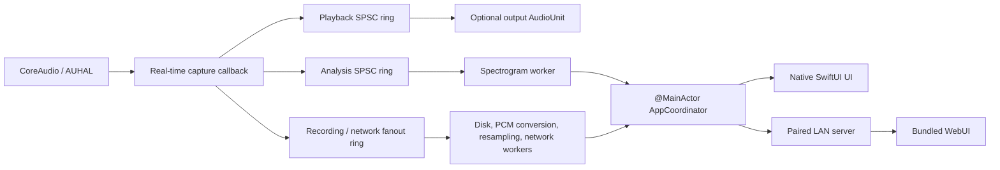

# Architecture

PhonoFlow remains a fully native macOS 26 application. SwiftUI and AppKit stay
in the application target; deterministic models and services belong in the
local Swift 6 `PhonoFlowCore` package.



## Ownership and concurrency

`AppCoordinator` is the authority for commands from both the native interface
and Remote Access. It is isolated to `@MainActor`. Audio callbacks and network
handlers publish data or request typed commands; they never mutate observable
UI state directly.

Production services are designed behind injectable interfaces for:

- CoreAudio HAL access
- preferences
- clock and randomness
- filesystem
- credentials/Keychain
- network transport

Tests substitute deterministic implementations, including a fake four-input
Scarlett-style device. A fake device models channel layout and hotplug behavior;
it does not claim to emulate Focusrite firmware or proprietary controls.

## Device identity and routing

Numeric `AudioDeviceID` values never leave the HAL adapter because they can
change across connection cycles. Public selection is:

```json
{
  "inputUID": "stable-coreaudio-input-uid",
  "inputRouteID": "channels-1-2",
  "outputUID": "stable-coreaudio-output-uid-or-null"
}
```

Each device description includes its stable UID, channel counts and names,
available input routes, supported sample rates, buffer-frame range, transport,
and connection state. Route labels use CoreAudio channel names when available
and fall back to `Inputs 1–2`, `Inputs 3–4`, and so on.

The AUHAL input client format is stereo, non-interleaved Float32. Its explicit
channel map converts the selected hardware pair into client channels:

- mono input: `[0, 0]`
- first stereo pair: `[0, 1]`
- second pair, including loopback when the device exposes it there: `[2, 3]`

Device selection is vendor-neutral. PhonoFlow does not hardcode a Focusrite
vendor ID, model name, or channel arrangement.

Input capture and output monitoring have separate lifecycles. Capture can feed
meters, recording, analysis, and remote clients without any output device.
Selecting a new output does not restart input capture. Output conversion follows
the output's native format rather than silently changing another device's
hardware sample rate.

Every CoreAudio `OSStatus` is converted to a typed engine failure. The public
engine lifecycle is:

- `idle`
- `starting`
- `running(format)`
- `disconnected`
- `failed(error)`

The application reports monitoring as active only after AudioUnit initialization
and start both succeed. Device-list and device-alive listeners support stable-UID
reconnection. Buffer allocation uses the negotiated
`MaximumFramesPerSlice`.

Input device, input route, and sample-rate changes conflict with active recording
and must return `409 Conflict` to a remote caller. A physical unplug safely
finalizes the current file before moving to `disconnected`.

## Real-time pipeline

The capture callback has a deliberately small contract:

1. Render planar samples from AUHAL.
2. Apply gain once, then real-time-safe EQ and limiting.
3. Update atomic counters and meters.
4. Copy samples into bounded single-producer/single-consumer rings.

The callback performs no locking, heap allocation, file I/O, interleaving, WAV
conversion, resampling, FFT work, image generation, or network sends. Playback,
analysis, and recording/network fanout use separate queues, so a slow output or
browser cannot consume data needed by another subsystem.

Workers use bounded queues and reusable buffers. Overflow, underflow, drops, and
queue depth are observable. A slow network client is evicted instead of being
allowed to accumulate unbounded latency or memory.

## Spectrogram

`SpectrogramProcessor` consumes arbitrary block sizes and source rates off the
real-time thread. Its fixed display contract is:

- normalization to 48,000 Hz
- 2,048-point Hann window
- 1,024-sample hop
- every normalized sample covered by the streaming windows
- maximum-power aggregation across hops into 15 columns per second
- 64 logarithmic rows from 20 Hz through 20 kHz
- −96 dB floor
- 64-column history

Each published column contains a monotonic sequence, a timestamp, and exactly 64
byte intensities. Native and browser renderers consume the same column data.
Native waveform and phase updates are capped at 30 Hz, spectrum publication at
15 Hz, and only one native render may be pending. Analysis is suspended when no
advanced native visualization or remote spectrum subscriber needs it.

Diagnostics cover callback duration, XRUNs, ring overflow/underflow, queue
depth/drops, FFT latency, render skips, image age, and memory growth.

## Native interface

The menu-bar popover is grouped into device, meter/gain, processing,
visualization, diagnostics, and action sections. Settings are organized into
General, Audio, Remote Access, Appearance, and Diagnostics.

On macOS 26, navigation, status chips, selection controls, and actions use the
native SwiftUI Liquid Glass APIs, including `GlassEffectContainer`,
`glassEffect`, glass button styles, effect IDs, and transitions. Waveform,
phase, and spectrogram plots remain on stable high-contrast surfaces rather than
stacking glass behind rapidly changing content.

The WebUI visually interprets the same hierarchy with CSS translucency and
depth. It does not claim to implement Apple's SwiftUI material in a browser.
Solid fallbacks are provided for reduced-transparency environments.

See [Accessibility](accessibility.md) for interaction and rendering
requirements.
